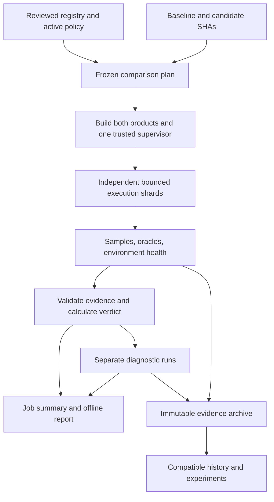

# AF continuous performance laboratory

**Status:** accepted. Proposed 16 October 2026; approved by the owner on 19 October 2026 for
implementation through AF Tasks, in the packages of §17. Package p1 (contracts, registry,
frozen planning and exact verdicts) is recorded by
[ADR-0162](../adr/0162-freeze-performance-plans-and-judge-them-by-exact-paired-verdicts.md)
package p2 (native public-API workloads and golden oracles) by
[ADR-0163](../adr/0163-measure-native-workloads-through-a-public-api-probe-and-independent-golden-oracles.md)
package p3a (build provenance and native supervision) by
[ADR-0166](../adr/0166-build-frozen-plans-and-supervise-samples-with-one-authority-instrument.md),
repaired by
[ADR-0167](../adr/0167-bound-every-supervisor-wait-and-verify-only-what-was-observed.md),
and package p3b (paired execution, CLI fixtures and health) by
[ADR-0168](../adr/0168-run-frozen-shards-with-whole-cli-oracles-and-only-a-per-sample-scratch.md),
completed by
[ADR-0169](../adr/0169-coordinate-a-machine-seed-each-side-once-and-build-linux-recipes-in-a-pinned-image.md)
and closed out with p2 by
[ADR-0170](../adr/0170-seed-native-fixtures-freeze-the-build-image-and-bound-the-run-by-one-deadline.md)
and
[ADR-0171](../adr/0171-cancel-samples-through-their-supervisor-carry-the-deadline-through-preflight-and-observe-history-order.md);
package p4 (reports, archive and history) by
[ADR-0172](../adr/0172-admit-candidate-files-through-bounded-descriptors-and-report-archive-and-trend-runs-offline.md),
which also closes inherited admission and oracle findings, and closed out by
[ADR-0173](../adr/0173-own-the-supervisor-a-test-runs-and-bound-admission-collection-scratch-and-cancellation-by-absolute-deadlines.md);
package p5 (traces, CPU profiles and diagnostic counters) by
[ADR-0174](../adr/0174-diagnose-in-separate-child-runs-that-record-only-the-bracketed-region-and-share-one-test-executable-boundary.md),
recovered by
[ADR-0175](../adr/0175-supervise-every-diagnostic-execution-admit-what-it-wrote-and-record-what-it-used.md)
and completed by
[ADR-0176](../adr/0176-diagnose-cli-cases-and-contained-linux-runs-and-bound-every-step-and-seed-before-it-is-used.md);
package p6a (continuous scheduling and trusted measurement authority) by
[ADR-0177](../adr/0177-schedule-continuous-runs-from-trusted-control-and-move-builds-once-to-bounded-shards.md);
the release handoff of package p6b by
[ADR-0180](../adr/0180-hand-off-published-releases-read-only-and-measure-each-claimed-identity-once.md);
and p6b's calibration cohorts, injection and readiness by
[ADR-0181](../adr/0181-declare-cohorts-before-they-run-inject-only-the-candidate-and-count-whole-power-trials.md).
p6b's activation verification is recorded by ADR-0183 and ADR-0184, and package p7 (guarded
kernel experiments) by
[ADR-0185](../adr/0185-measure-guarded-kernel-experiments-through-a-literal-bootstrap-over-a-protected-harness.md);
package p8's integrated acceptance repairs by
[ADR-0186](../adr/0186-fold-protected-paths-key-warm-targets-by-the-whole-snapshot-bound-measure-output-and-replan-bridge-runs.md)
and its closeout by
[ADR-0187](../adr/0187-bind-kernel-receipts-to-their-task-results-word-reports-by-what-was-admitted-and-retain-a-real-local-run.md),
with its hosted, multi-day and operator acceptance pending as
[`performance-acceptance.md`](../performance-acceptance.md) records.
Accepted design SHA256:
`624f64e658cdd63346d77943ebc1691651d9aa87be5a84fa66017bf4cf740803`.

This is the current design. It superseded an earlier draft written after an Opus review and
incorporates selected findings from another agent's research; those drafts and the research
assessment were scratch artifacts outside the repository and are not kept here. It does not
claim measured performance, or approval of these amendments by the earlier Opus review.
Repository snapshot used for this proposal:
`c40defd73309d9a041442f8718b588d7e8601be2` (AF 0.12.0-rc.3).

## 1. Decision in brief

Build one configurable performance laboratory that works locally, in CI, and as an
instrument for AF experiments. Its job is to answer four questions with retained evidence:

1. Did this PR or release make a critical operation materially slower?
2. Does the shipping product meet its stated speed targets on the named environments?
3. Which functions, phases, allocations, or resource constraints explain the change?
4. Can an optimization experiment reproduce and improve the result without changing the measuring instrument?

Every comparison runs baseline and candidate on the same machine, with the same fixtures,
build recipe, instrument, and correctness checks. A frozen plan fixes the workload,
sample count, order, policy, and resource budget before measurement. Independent shards
provide elasticity; cases on one machine execute serially.

The PR result distinguishes **pass**, **regression**, and **incomplete evidence**.
An uncertain result is visible and actionable. It is never presented as proof of speed.
The system starts advisory; a required check is enabled only after real cost, reliability,
and detection-power evidence. If hosted runners cannot support the intended sensitivity,
we change capacity or use an appropriately isolated runner before claiming enforcement.

The report is the main interface: a comparison table, raw sample plots, confidence
bounds, correctness failures, environment health, traces, and baseline/candidate/difference
flamegraphs. JSON and a self-contained HTML report accompany the GitHub job summary.
An append-only archive preserves history beyond CI artifact expiry. No database or
hosted dashboard is required to run or inspect a comparison.

The initial coverage includes the large-package startup paths from issue #255. We first
establish a reproducible baseline; optimizing that issue follows the working laboratory.
Production leases, validation, CAS limits, and correctness remain product constraints.

## 2. What we take from the research

The useful ClickHouse pattern is a parameterized workload registry, paired execution,
bounded diagnostic work, and profiles retained beside results. Its comparison script
separates profile collection and tracks a profiling budget. AF adopts these mechanisms;
it does not inherit ClickHouse's thresholds or require a ClickHouse deployment.
[ClickHouse comparison pipeline](https://github.com/ClickHouse/ClickHouse/blob/master/ci/jobs/scripts/perf/compare.sh).

| Research suggestion | Design decision |
| --- | --- |
| More samples where execution is cheap | Adopt fixed **per-case** counts, initially 40 pairs for cheap quick cases and 20 for expensive ones; calibrate before activation. |
| Better use of statistical power | Count only critical instances in the corrected gate family. Pass requires an upper confidence bound within tolerance; proving equivalence on both sides is unnecessary. |
| A/A checks during a run | Adopt baseline-versus-baseline sentinels, raw sequence plots, and explicit health flags. |
| Avoid CPU-quota artifacts | Use a declared CPU set, verified memory/swap constraints, and observed interference counters. Quota-limited performance is a separate environment contract. |
| Instruction/allocation counters | Add bounded diagnostic recipes. They explain work performed; wall-clock speed remains the product metric. |
| Better profiles | Use frame-pointer capture with an explicit DWARF alternative, approximately 1 kHz sampling, existing flamegraph tooling, and retained symbols. |
| Durable history and useful CI output | Adopt a filesystem archive, compatible history views, and a standard job-summary table. |
| Replace the statistical method with Wilcoxon | Defer. AF's baseline-normalized losses are not symmetric by construction; the proposed replacement needs a different estimand and validated assumptions. |
| Automatically extend a run until decisive | Defer. Fixed-N confidence intervals do not automatically remain valid under data-dependent stopping. |
| Make inconclusive green; replace the speed budget with p95 | Reject. Neither establishes the current product promise. |
| Change-point alerts, automatic bisection, concurrent “duet” runs | Later extensions, after enough reliable history exists. |

Provenance note: a research assessment written beside the proposal recorded the detailed
dispositions, including corrections to the survey's statistical claims and simulation labels.
It was a scratch artifact outside the repository and is not kept; the table above is its
binding outcome.

## 3. Architecture and product boundary



| Component | Responsibility |
| --- | --- |
| `fixtures/performance/suite.toml` | Versioned cases, parameter domains, oracles, metric policies, recipes, environments, and limits. |
| `scripts/performance/` | Python 3.9+ planning, orchestration, exact statistics, evidence validation, reports, archive, and history. Use vendored unmodified Tomli 2.2.1 with license and digest; no runtime dependency downloads. |
| `review-pipeline` example `perf-probe` | Call existing public Rust APIs, expose named timing regions, and produce checked results. |
| `review-process` example `perf-supervisor` | One authority-built native timing/supervision instrument shared by both measured sides. |
| Diagnostic recipes | Feature-gated spans, Linux perf, optional macOS samply, and counter collection. |
| CI workflows | Resolve events, prepare dependencies, build once, dispatch shards, aggregate, and retain evidence. |

A **Performance Case** is a workload plus its oracle, timing boundary, and policy.
A **Sample** is one execution, including a failed execution. A **Run** is a frozen plan
and its evidence. A **Verdict** is the laboratory's classification. These are distinct
from the Review Kernel's Measurement, MeasurementComparison, Evidence, and Demand.
Only the explicit experiment adapter emits the kernel's existing command-report protocol.

AF remains a bin-only CLI. The probe uses public library APIs; real startup is measured
by launching the actual AF binary. This design does not require a library refactor.
Domain definitions and a new ADR will document the boundary during implementation.
All product changes will use AF implementation and verification Tasks under ADR-0142.

## 4. Workloads and correctness

All instances below are critical in their declared tiers. Large or inconvenient cases
cannot be silently omitted or downgraded when a run fails.

| Family | Initial coverage | Tiers |
| --- | --- | --- |
| CLI discovery | `--version`, `--help`, `task --help`, `review run --help`; whole process | Quick, nightly, release |
| Canonical data | Serialize and validate separately: small, approximately 1.9 MB, and exactly 5,605,230-byte typed envelopes | Quick, nightly |
| CAS | Raw get/verify and typed get/validate on matching fixtures; setup excluded | Quick, nightly |
| Source capture | Production git capture of 100 or 10,000 deterministic 128-byte files | 100 quick; both nightly |
| State library | Cold application projection and prewarmed projection of exactly 10,000 valid relevant events | Quick, nightly |
| Authority library | Current-plan check and first `TaskRuntime::new`; two-node graphs at both large package sizes, fresh valid leases | Quick, nightly |
| CLI Task | Start without execution; separately run RootInputs plus check(`true`), with the check proved executed | Quick, nightly, release |
| CLI state | `task show`, `review ledger`, `review report` against matching 10,000-event Task/Campaign fixtures | Quick, nightly, release |
| Persistence diagnostic | Real filesystem CAS write/read and state append/read, with declared flush semantics and logical bytes | Advisory nightly/manual |

Issue #255's reported 11.044 CPU seconds is historical motivation, not a current
measurement. Its projection, decoding/validation, and serialization spans overlap.
The laboratory must not add them into a false total. Its Task lease is production's
60-second lease (15 seconds until ADR-0209 lengthened it), and its 8,388,608-byte CAS
envelope cap is production's too; the laboratory never changes either. Fixture size means
serialized envelope bytes; generation verifies exact sizes and the cap boundary.

Every timed execution also passes an independent oracle. Library results match committed
canonical digests, counts, or semantic projections generated from checked reference
bytes. The candidate cannot generate its own expected answer. CLI oracles check the
side's actual package version, command-specific usage tokens, expected Task outcome,
or selected state fields; they do not freeze all help/report formatting. Empty output
does not pass. Each release creates its own state through its supported writers;
no old-state reader or raw-SQL fixture shortcut is introduced into AF.

A wrong result fails only the side that produced it. An intentional semantic transition
requires a versioned, owner-reviewed oracle enumerating the accepted old/new forms,
with an equivalence rationale and fixtures, before the product change. No wildcard
acceptance or automatic learning from observed output is allowed.

Cache treatment is explicit: fresh process, fresh Store, application-cold projection,
and warm OS page cache are different properties. The default does not flush OS caches
or claim cold physical I/O. Every sample uses private HOME/XDG directories and fixture
locks without a release pin; the executed binary hash must match the plan.

## 5. Baselines, recipes, and compatibility

| Trigger | Baseline | Candidate |
| --- | --- | --- |
| PR to main | First parent of the exact PR merge commit | That merge commit |
| Main push | First parent of the pushed SHA | Pushed SHA |
| Nightly | Highest stable semver tag reachable from frozen main | Frozen main tip |
| Published release | Highest smaller stable semver; prerelease predecessors allowed only for a prerelease candidate | Exact published tag SHA |
| Manual experiment | Explicit resolved ref | Explicit resolved ref |

Resolve selectors once to full SHAs. Missing parents, ambiguous release tags, unsupported
baselines, and unresolved refs are explicit unavailable results. They never select a more
convenient baseline. A PR's control revision equals its baseline; disagreement with the
event's base SHA refuses the plan. Record PR head, merge base, and event metadata too.

Quick CI uses native uninstrumented release builds on the declared Linux GNU environment.
Nightly/release use the shipping Linux musl recipe; compatible manual runs can use native
macOS arm64. Recipe identities bind the authority's exact toolchain, target, linker,
Cargo.lock, flags, features, and container digest. At the design base these are Rust
1.88.0 and, for Linux shipping, cargo-zigbuild 0.23.4 with Zig 0.15.2. Implementation
must verify the source-pinned recipe rather than silently upgrade it.

One credential-free build job builds both products and the authority supervisor, then
publishes hashed run-scoped artifacts. Shards verify those bytes and never rebuild.
Use detached worktrees with correct embedded commits under the checkout's
`target/performance/<run>/worktrees/{authority,base,head}`, each with its own target.
The run owns its cleanup. No build targets live under temporary or global cache paths.

Native probe adapters are copied from the trusted authority into measured worktrees.
For each case contract, at most four declared equivalent adapters have a unique fixed
priority. Compile with locked dependencies before timing; select the first compiling
adapter and record every outcome. Runtime oracle failure never causes fallback. Do not
replace product manifests or crates to force compatibility. Initial native support is
the implementation base and descendants that pass this check; older releases may have
explicit CLI adapters. Missing critical release coverage makes the full result incomplete.

Cross-adapter comparisons identify both adapters and their reviewed equivalence group.
A narrowly scoped API bridge may use owner-reviewed equivalence admission: unchanged
workload, timing, oracle, and policy; actual golden checks on both product sources;
then post-merge A/A before claiming the new adapter calibrated. A changed workload or
timing boundary needs a new contract and full calibration. Prepared release binaries
require verified repository release signatures and matching target/recipe families.

## 6. Execution, noise, and elasticity

Instances are sorted and assigned round-robin to the frozen shard count. A pair always
runs on one host; cases are serial within it. Each case has two warmup pairs followed
by its fixed measured pairs. Each two-pair block uses a seeded choice between AB/BA
and BA/AB. Preserve all warmups and failures. No outlier deletion, replacement sample,
automatic confirmation run, or result-dependent increase in N occurs.

Quick defaults are **40 pairs** for discovery and small canonical/CAS cases, and
**20 pairs** for the remaining initial cases. Nightly/release default to **40**.
These are initial policy choices, not demonstrated sufficient counts. Readiness can
require a reviewed increase before activation. Parameter sweeps, pair counts, shards,
runner profiles, and diagnostic recipes are configurable within declared bounds.
Manual subsets say `partial_scope` and cannot satisfy the full PR check.

Linux samples use a pinned container with a native PID-1 supervisor: network disabled,
read-only root/source/binaries, private scratch, dropped capabilities, no-new-privileges,
256-PID and 4-GiB memory limits, and verified swap disabled. CPU placement uses two
available logical CPUs, preferring separate physical cores where topology permits.
Record the actual CPU IDs, SMT relationship, affinity, and inherited limits. A larger
or one-CPU environment is a separate declared profile. Affinity does not claim exclusive
ownership of hosted CPUs. Independent concurrent shards require separate hosts.

The default adds no CPU bandwidth quota. Quotas can throttle a workload within their
accounting period; CPU sets instead constrain where it executes. Explicitly quota-limited
experiments have their own recipe/environment identity. Record inherited quotas and
throttling; a required environment capability that cannot be verified is unavailable.
[Docker resource constraints](https://docs.docker.com/engine/containers/resource_constraints/).

Per-sample scratch has a 2-GiB disk limit, not an unbounded tmpfs. CLI fixtures set the
same recorded private `AF_STORAGE__MIN_FREE_BYTES=256MiB` on both sides so the check can
actually execute there. AF's production default and the host's 10-GiB free-space floor
remain unchanged. Builds have bounded writable targets and pre-fetched locked
dependencies. Untrusted build scripts and measured code receive no credentials.

The environment is constructed from an allowlist: private HOME/XDG/TMPDIR, fixed PATH,
locale/timezone, declared compiler and thread controls, and case-approved AF settings.
Timeout kills the entire sample container and verifies exit, including descendants
that create new sessions. Unconfirmed cleanup stops the shard. Logs are drained into
capped files; truncation is counted. Neither container setup nor teardown belongs in
the AF child-lifetime metric. An AF command must finish its expected work before exit;
unexpected live descendants fail its lifecycle oracle rather than produce a fast success.
The supervisor's clock brackets child launch through observed child exit; its own startup
is excluded. Record descendant cleanup separately and test this boundary explicitly.

macOS execution is local and explicitly trusted. In v1, timing covers discovery and
known nonspawning library cases; process groups do not claim Linux namespace isolation.
Spawning cases require Linux. Missing Docker or containment capability has no weaker
automatic fallback.

### Run-health observations

Each shard brackets its measured schedule with five baseline-versus-baseline sentinel
pairs at the start and five at the end. Both sides use the same baseline binary and
a fixed small canonical workload repeated a registry-declared number of times; the
golden digest checks all repetitions. This is health evidence, not another product
metric in the gate family. Its batch size is fixed before calibration, never tuned
after seeing candidate results.

The initial declared health rule flags an absolute start/end median shift above 20%,
or within-phase median absolute deviation above 20% of its median, using a 1-ms denominator
floor. These provisional limits and the sentinel batch size must survive the readiness
cohort; changing them starts a new cohort. Oracle failure, missing sentinel evidence,
or a flagged shard makes its critical scope `environment_unstable` and incomplete.
Keep every numerical result; this does not establish that the environment caused a
product slowdown. Noisy samples are never removed to make the comparison pass.

Collect available per-sample user/system CPU, context switches, faults, cgroup CPU and
memory events, pressure, and host steal/load observations. Host identity includes CPU
model/topology, kernel/image, libc, memory, virtualization, microcode where exposed,
container runtime, affinity/quota, and cache/ASLR policies. Unsupported observations
are explicitly unknown. They do not become invented zeroes or reasons to discard data.

Primary wall time uses monotonic nanoseconds and exact decimal conversion. Library
regions name their setup exclusions. `cgroup_peak_memory_bytes` is the process-tree
memory diagnostic, including accounted cache; it is not RSS. The kernel documents
`memory.peak` as cgroup-and-descendant peak usage.
[cgroup v2 documentation](https://www.kernel.org/doc/html/latest/admin-guide/cgroup-v2.html).
`wait4_maxrss_bytes` and CPU are separately labeled OS-accounted values with platform
unit conversion and descendant-accounting tests; overlapping records are not summed.
Optional metrics carry an unavailable reason; required missing metrics fail the sample.

## 7. What makes a regression or a pass

The primary metric is wall time. Each critical case instance has exactly one primary
metric with a reviewed relative tolerance `r` and strictly positive absolute tolerance
`a`. Initial wall-time policy is `r = 0.05`, `a = 1 ms`; any different case value must
be explicit in the registry and calibrated. This floor prevents tiny absolute changes
from becoming large percentage alarms. It is not a claim that hosted CI resolves 5%.

Algorithm **`paired_median_tolerance_v2`** computes, for baseline A and candidate B:

```text
T_i = max(r * A_i, a)
z_i = (B_i - A_i) / T_i               # lower is better
z_i = (A_i - B_i) / T_i               # higher is better
```

The estimand is median normalized paired loss, not the ratio of two independent medians.
Use exact rational arithmetic. Zero baseline is defined because `a > 0`; descriptive
percentage change is null when its denominator is zero.

Freeze **K = number of critical primary-metric instances**, across all shards, before
execution. Advisory cases do not enlarge K. For each critical case with planned N pairs,
find the largest `k >= 1`, at most `floor((N+1)/2)`, satisfying:

```text
2 * sum(comb(N,j), j = 0 .. k-1) / 2^N <= 0.05 / K
[L,U] = [sorted_z[k], sorted_z[N-k+1]]  # one-based order statistics
```

Refuse impossible N/K at plan time. Retain ties and boundary equality. Missing/failed
pairs invalidate the case's numerical verdict; they do not shrink N. Advisory intervals
use 0.05 individually and are labeled exploratory, with no aggregate error claim.

| Bound | Case interpretation | Relative gate |
| --- | --- | --- |
| `L > 1` | Material regression | Fail |
| `U < -1` | Material improvement | Eligible to pass |
| `L >= -1` and `U <= 1` | Within tolerance | Eligible to pass |
| `L < -1` and `-1 <= U <= 1` | No material regression established; improvement size uncertain | Eligible to pass |
| Otherwise | Inconclusive; material regression remains plausible | Incomplete |

Thus **passing requires `U <= 1`**, complete valid evidence, healthy execution, and any
enabled applicable absolute budget. Failure to detect a regression alone is insufficient.
For example, `[-2, 0.5]` can pass, while `[-0.2, 1.4]` cannot. Do not mislabel the former
as proof of equivalence. Report medians, absolute/percentage changes, nearest-rank p95,
the actual interval, and the effective tolerance separately.

These order-statistic intervals rely on independent, identically distributed paired
losses; Bonferroni handles the family without assuming independence between cases.
Interleaving and calibration help assess real execution but cannot prove independence
or repair arbitrary autocorrelation. Advertise calibrated empirical behavior, not a
universal error or detection-rate guarantee. The implementation includes exact boundary
fixtures, zeroes, ties, and synthetic noise experiments labeled as synthetic.

| Other condition | Critical aggregate result |
| --- | --- |
| Candidate functional failure, all baseline samples valid | Fail, exit 3; no speed claim |
| Baseline failure, or failures on both sides | Incomplete, exit 4; preserve any candidate failure |
| Missing/duplicate records, build incompatibility, wrong identity, unstable environment | Incomplete, exit 4 |
| Enabled applicable speed budget missed | Fail, exit 3 |
| Invalid plan/input before execution | Exit 2 |
| All critical cases eligible, evidence complete | Pass, exit 0 |

Functional failures include oracle mismatch, timeout, production lease expiry, nonzero
exit, and required metrics missing inside a present record. A missing record is coverage
failure. Global integrity/coverage failure takes precedence over fail, then pass; all
individual regressions remain visible. Advisory case failures alone do not block complete
critical scope. Incomplete is a completed non-passing check with a reason, not an
indefinitely pending job. A manual rerun gets a new ID and parent link; it never erases
the original result.

## 8. What “fast” means

| Product target | Demonstration contract |
| --- | --- |
| CLI discovery under **50 ms** | Each of the four discovery commands; shipping binary; 20 fresh processes; private HOME; warm OS page cache |
| State reads under **200 ms** | Each of the three state commands; exactly 10,000 relevant events; matching shipping recipe/cache treatment |

A target is met on the **named environment** only when every measured sample is strictly
below it; equality fails. Show maximum, median, p95, binary identity, and health evidence.
More samples means checking all of them. This is a finite observed budget demonstration,
not a guarantee about every future invocation or every user's machine.

Initial environments are hosted Linux x86_64 GNU for quick comparisons, hosted Linux
x86_64 musl for shipping, and a named local macOS arm64 host for discovery. Each includes
its exact hardware/image fingerprint. macOS state-read budget coverage is unavailable
in v1. A GNU PR comparison cannot satisfy a musl shipping target.

Budgets begin `pending_calibration`. After the real demonstration, a reviewed policy may
enable them for matching nightly/release/manual runs. A miss creates optimization work;
it cannot be fixed by changing to p95 or omitting slow samples. PR quick checks enforce
relative regressions. Release reports expose relative and absolute outcomes but remain
advisory for publication, as required by the release contract.

## 9. Traces, flamegraphs, and investigation

Verdict samples always use uninstrumented release binaries. Diagnostics are separate
runs with separate identities and a link to their parent comparison. Automatic selection
prioritizes regressed cases, then inconclusive cases, by stable case ID within each
class; manual selection is explicit. Select at most three cases by default, eight hard
maximum. Diagnostic failure cannot erase or reverse the timing verdict.

Linux diagnostic builds retain debug symbols and frame pointers. Capture at 997 Hz for
10 seconds per side by default, with 30 seconds and 1,999 Hz hard limits. Short workloads
repeat with fresh declared state within that diagnostic interval. Record actual sample
counts, lost samples, unknown-frame fraction, tool version, and effective frequency.
First use frame-pointer unwinding. A declared alternative uses DWARF with a 32-KiB stack
capture; allow at most one additional capture per side and retain both. Stack-quality
fixtures must demonstrate usable unwinding for the supported recipe. This choice matters
because perf documents invalid frame-pointer call graphs for code built without the
necessary frame pointers. [perf record documentation](https://man7.org/linux/man-pages/man1/perf-record.1.html).

Profiling requires a probed, configured host capability. The tool does not run sudo,
change kernel sysctls, or grant privileges. Fork PRs only use ephemeral hosted runners;
a missing profile capability produces a clear unavailable result and reproduction
command. Trusted main/nightly/manual jobs may use a configured dedicated executor.
Shipping the flamegraph capability requires a real symbolized Linux capture, not only
synthetic renderer tests.

Use pinned **inferno** for collapsed-stack rendering rather than implement flamegraph
layout ourselves. Retain raw capture, collapsed stacks, build IDs, and matching symbols
or content-addressed symbol references. Render baseline/candidate graphs and normalized
differential views in both directions so disappearing stacks remain visible. Color means
change in CPU sample share; it is not an absolute time saving. Preserve unknown frames.
Use deterministic colors and script-free SVG in the report; inferno exposes these controls.
[inferno renderer source](https://github.com/jonhoo/inferno/blob/main/src/bin/flamegraph.rs).

Phase spans use a default-off `perf-trace` feature and cover canonicalization, CAS,
projection, authority, and startup composition. Export bounded timestamps, PID/TID,
span/parent IDs, and dropped-span counts. No payloads, prompts, or credentials. Overlapping
spans are never summed; a Perfetto-compatible export uses valid nested tracks or explicit
async tracks for non-nested work. Include an offline phase timeline in the HTML report.
Measure trace-on/off overhead; the target is median overhead at most 2% per native case.
Above-target traces remain useful but are visibly labeled perturbing.

Optional v1 diagnostic adapters add allocation count/bytes and Callgrind instruction
counts for selected small library cases, with separate pinned recipes and bounds.
Counts are explanatory proxies; stable instruction counts do not prove that a wall-time
change is noise. Optional local macOS capture uses **samply** for supported self-built
executables, preserving its profile and symbols. Capability checks must account for
macOS executable restrictions; do not install, sign, or change privileges automatically.
No automatic browser launch, hosted upload, or dependency on a hosted viewer is required.
[samply documentation](https://github.com/mstange/samply).

## 10. Configuration and user workflow

The initial interface is `python3 scripts/performance/cli.py`; adding a new public
`af perf` command is outside v1. The same commands and run format work locally and in CI.

| Command | Purpose |
| --- | --- |
| `list --suite PATH` | Validate cases, capabilities, parameter domains, and policies without building. |
| `plan --base REF --head REF --tier TIER` | Resolve and freeze the complete comparison. |
| `run --plan PATH --shard I` | Execute exactly that frozen shard. |
| `compare --run DIR` / `report --run DIR` | Recompute and inspect existing evidence; never add samples. |
| `profile --plan PATH --case ID` | Create a bounded diagnostic child run. |
| `history --inputs DIR... --output DIR` | Browse compatible series and link back to complete runs. |
| `archive --import DIR --root DIR` / `archive --fetch ACTIONS_RUN_ID --root DIR` | Verify and preserve evidence locally or from the configured repository. |
| `measure --case ID --metric KEY` | Supply one inner sample to one kernel repetition. |
| `harness-digest` | Compute the protected instrument digest for experiment policy. |
| `plan --scope calibration --authority SHA --cohort PATH` | Plan a predeclared proposed-policy readiness member. |
| `activate --verify --manifest PATH` | Recompute proposed activation evidence; never edit rulesets or activate policy itself. |

The registry separates **workload** (parameters, oracle, cache and timing scope),
**policy** (criticality, tolerances, budgets and samples), **recipe** (build/instrument),
and **environment** (capabilities and resources). Extensions declare these explicitly.
Parameter domains are finite integer/enum lists; expansion happens before sharding.
Exactly one primary metric is selected per instance. Optional metrics do not create
hidden statistical tests. Scopes are `full`, `partial_scope`, `bootstrap`, `calibration`,
or `diagnostic`; only complete active-policy full scope can satisfy the required check.

A developer reads the PR summary, opens the regressed case, examines raw pairs and health,
then follows its profile/trace or runs the supplied exact reproduction command on a
compatible host. An experiment selects explicit commits and parameters, records its
parent run and hypothesis, and retains every attempt. The report never combines
different hardware, cache policies, targets, or recipes into a purported paired verdict.

## 11. Evidence and history

Independent closed schemas cover suite, run, builds, samples, shards, verdict, profiles,
cohort, calibration parameters, readiness, and activation. Unknown versions or fields
fail closed. Each schema ships with valid/invalid golden examples and its reader/writer.
There is no automatic migration of earlier laboratory shapes or AF persisted state.

| Evidence | Required identity and contents |
| --- | --- |
| `run.json` | Selectors and resolved source/control/authority SHAs; scope; policy, recipe, instrument and fixture digests; expected cases/shards; per-case N, warmups, seed/order; environment, health rules, limits; plan digest |
| `builds.json` | Per-side source/overlay, chosen adapter and binary hashes; shared supervisor hash; compiler/linker/target/flags; sanitized argv/environment; statuses and logs |
| `samples.jsonl` | Case/side/pair/order/phase, source/binary/host identity, exact metrics and scope, oracle, failure, timestamp, log hashes/truncation; sentinels identified separately |
| `shard.json` | Expected record set, counts, hashes, start/end host health, completion status, artifact sizes |
| `verdict.json` | Input hashes, algorithm, K/alpha, N, exact rational bounds, classifications, budgets, health and aggregate reason |
| `profiles.json` | Parent run, case/side, diagnostic recipe and binary, tools, capture bounds, symbols/unwind/loss, artifact hashes or explicit omission |
| Cohort/readiness files | Declared membership; frozen calibration inputs; every success/failure/missing member; reproducible readiness calculation |

The frozen plan is never rewritten when builds select adapters. Resolved selections
belong in build evidence. Run IDs are opaque; hashes identify bytes. Canonical plan JSON
uses sorted keys, UTF-8, compact separators, no floats, significant array order, and
excludes only its own digest field. Every bundle has a sorted path/size/SHA256 manifest
whose own hash identifies the bundle. Rehash all entries; reject missing/extra files,
symlinks, absolute/traversing paths, duplicate IDs, and unexpected sample records.

IDs match `[a-z][a-z0-9_]{0,63}`. Metrics use canonical nonnegative decimal strings,
at most 38 significant digits, no exponent or redundant zeroes; units are `ms`, `bytes`,
`count`, or `ratio`. Derived signed values and bounds use exact signed rationals.
Commands are argv arrays with declared placeholders, never interpolated shell text.
Control messages and JSONL records are at most 64 KiB. The native probe reports
`af.perf-probe/1` with case/contract/fixture/parameter identity, metrics, and correctness;
its output is checked against authority golden entries, independently on each side.

The aggregator reconstructs every planned sample and sentinel slot. A failed shard
still uploads its terminal manifest and partial evidence where possible. Missing uploads
remain incomplete. Reports show failures, incomplete counts, calibrated detection
evidence, and per-case sensitivity limits; they do not invent a per-run “minimum detectable
effect” from a single observed interval.

The HTML is self-contained with a searchable table, raw-order plots including warmups,
provenance, failures, graph/trace links, and downloads. Escape all evidence text and
validate paths. Use CSP with only hash-authorized bundled code/styles and local images;
no arbitrary evidence URLs, external scripts, or CDN. GitHub receives the same compact
comparison table in the job summary; no automatic PR comments.

### Durable archive

CI artifacts are transport: PR evidence remains there 14 days and main/nightly/release
evidence 90 days. A trusted operator-configured collector runs the archive command on
a persistent filesystem, separately from benchmark execution. It needs only repository
contents/actions read access and archive write access. It validates downloaded data and
never imports or executes code from it. Untrusted samples receive no archive credentials.
Archive automation and capacity must be demonstrated before claiming continuous history.

Content-addressed objects plus an append-only run index preserve raw numeric samples,
plans, build manifests, verdicts, and summaries for at least 365 days. Profiles/logs and
matching symbol objects default to 90 days. Full active calibration cohorts and release
budget demonstrations are pinned until superseded and then for 365 days. Garbage
collection traces references; it never evicts active evidence to make room. Large
artifact expiration creates an explicit retention record, not a silently changed bundle.
The compact retained view preserves the original manifest and identifies which objects
remain available. There is no claim of full profile reproducibility after symbols expire.

Archive capacity defaults to 100 GiB, maximum 1 TiB without reviewed policy change.
Exhaustion stops imports with a visible archive-health error; benchmarks retain their
bounded CI artifacts. Collection lag and available capacity appear in operational status;
activation requires demonstrated collection before transport expiry. History groups by
case/fixture, policy, recipe, and environment identity. Trends compare compatible groups;
they do not imply a same-host experiment. Object-store/ClickHouse backends and automated
change-point alerts can consume this format later.

## 12. CI authority, releases, and exceptions

PRs targeting main, main pushes, nightly schedules, and explicit dispatch use the same
planner. Exclude Remote Check `af-gate/**` base branches. Pin actions; use read-only
permissions and no secrets. Do not execute candidate code through `pull_request_target`.
Only explicitly trusted runs can select persistent/dedicated executors.

The control revision selects `fixtures/performance/activation.toml`, binding an immutable
reachable authority SHA, policy digest, readiness bytes hash, cohort Actions run IDs,
and a tagged admission (`calibrated` or `equivalent_adapter`). Its driver, fixtures,
supervisor, recipes, and policy measure both products. Candidate changes to these inputs
are labeled `harness_changed`; they cannot change their own PR's thresholds or coverage.
Owner review of authority/workflow paths at the exact current head, with stale approval
dismissal, is an administrative prerequisite. A candidate-controlled PR workflow is not
a cryptographic defense against a hostile author.

Policy PRs also run non-required proposed-policy bootstrap comparisons `(base, merge)`
and `(merge, merge)` under the same untrusted containment. After merge, the proposed
authority receives a calibration cohort, then a separate reviewed activation change.
Calibration explicitly accepts a proposed SHA reachable from the frozen trusted control
revision without requiring an existing activation manifest: first activation is possible.
Before activation, full-check status is unavailable and branch protection remains advisory.
Substantive case/oracle/tolerance/N/recipe/environment/instrument changes require a new
cohort; narrow equivalent adapters follow the explicit exception in section 5.

Activation CI uses trusted control code to fetch the declared retained Actions artifacts,
rehash exact cohort/readiness bytes, and recompute membership, classifications, injection
validity, and fixed denominators. Author-written readiness success is not authoritative.
Missing or expired promotion evidence refuses activation. The archive is a retention
backup, not an alternate unverified promotion source. Ordinary PRs verify the already
reviewed activation locally without fetching the old cohort every time.
For equivalent-adapter admission, verification also checks that the protected diff is
limited to the named adapter files and registry support entries, with unchanged case,
fixture, timing, and policy contracts. Owner review establishes semantic equivalence;
a matching file list alone does not.

Release performance is triggered by completed upstream `Release` workflow runs. Verify
same repository, eligible push to main or release tag, exact published nondraft tag/SHA,
and successful `sign and publish` job across upstream attempts. Publication success
with a failed pin job is eligible; main without a published tag is not. The downstream
workflow is read-only and does not execute upstream artifacts as workflow code.

Deduplicate by upstream run ID + tag + SHA, ignoring attempt number. Serialize that
identity and write an immutable claim artifact before sampling. Later pin-only reruns
link the retained result; a claim with no result is incomplete, not an automatic rerun.
Unavailable/expired deduplication history runs nothing. Explicit manual `remeasure_of`
creates a new measurement. Release results remain advisory for publication.

The operational runbook must demonstrate the handoff and duplicate behavior in a staging
repository, including publication success/pin failure, without handing publishing
credentials to an AF Task. Before making `Performance / aggregate` required, export
rulesets and verify coexistence with the existing authorized release-pin push. If it
does not work, remain advisory and propose a separate release/ruleset decision.

An intentional regression remains a regression in the evidence. V1 has no automated
“accepted means green” switch. An owner may document an exact-head tradeoff naming cases,
run IDs, reasons, and follow-up work; any administrative merge exception is separately
authorized and recorded. Infrastructure incidents likewise require explicit operator
recovery: record the outage, export/change the required-check setting, repair and
recalibrate, then restore it. The laboratory neither grants bypass authority nor changes
rulesets automatically. This keeps the measured outcome distinct from a product decision.

## 13. AF experiments

Local paired experiments use the same frozen plans and reports. Kernel experiments use
the existing Measurement/Comparison contract: `measure` emits one sample per kernel
repetition, not an inner median, paired CI comparator, or undeclared retry.

Its last stdout line, at most 64 KiB, has the existing exact protocol:

```json
{"schema":"af.measure-report/1","metrics":{"wall_ms":{"value":"12.34","unit":"ms"}}}
```

Only the declared metric keys/units and canonical values are accepted. Failure exits
nonzero with diagnostics and no successful report. The kernel controls repetitions,
whole-command `elapsed_ms`, comparison, and its requirement for improvement.

The measured snapshot is read-only. Setup/build/logs use `AF_CHECK_SCRATCH` and the
kernel-provided cargo target cache; missing offline inputs fail. V1 inner measurements
support nonspawning library cases under kernel supervision, not nested Docker or CLI
workloads needing namespace isolation. Inner operation time excludes setup, while
kernel elapsed time still includes command cost.

The captured authority policy contains a literal isolated Python bootstrap and an exact
protected-input digest. Before importing candidate harness code or building, it checks
paths and bytes for the driver, fixtures, probe/adapters, Cargo manifests/lock, build.rs,
toolchain and `.cargo` configuration. Reject symlinks, missing/extra protected files,
and mismatches. Candidate optimizations cannot edit these instrument paths.

Stage the policy under `fixtures/performance/kernel-measure/`; the staged nonexecuted
policy subtree is the only digest exclusion to avoid hashing its own expected digest.
Workers do not install `.af/` authority. Reviewed human installation/re-pinning follows
build-input/dependency/version changes, with a deterministic digest check in repository
checks and release preparation. Until a real tampered-candidate integration test proves
the guard, experiments use only kernel-observed elapsed time. Afterwards they may select
the guarded inner metric. Golden oracles and code review remain necessary: a protected
harness does not make arbitrary product code trustworthy.

## 14. Resource contract

| Resource | Default | Hard maximum |
| --- | --- | --- |
| Measured pairs | Quick 40 cheap / 20 other; nightly/release 40 | 200, even; minimum 12 |
| Warmup pairs | 2 | 10 |
| Expanded product instances | Registry selection | 64; health sentinels separate |
| Sample wall time | 30 s | 120 s |
| Each instrument/product build | 20 min | 45 min |
| Quick shard sampling / total run wall | 15 / 60 min | 30 / 120 min |
| Nightly/release/manual sampling / total | 45 / 120 min | 90 / 180 min |
| Shards / concurrent jobs | Quick 2/2; nightly 4/4 | 16/8; never more shards than instances |
| Sample stdout + stderr | 256 KiB | 1 MiB |
| Per-shard result bundle, including diagnostics | 128 MiB | 512 MiB |
| Shared build artifacts | 1 GiB | 4 GiB |
| Run worktrees + targets | 40 GiB | 80 GiB |
| Free disk floor | 10 GiB | Cannot be lowered by run input |
| Diagnostic CPU capture | 10 s × 997 Hz × up to 3 cases, each side | 30 s × 1,999 Hz × 8 cases; one declared unwind alternative |
| Optional counter sample | 120 s | 300 s; same diagnostic deadline/byte cap |
| Separate diagnostic child-run wall | 15 min | 30 min including builds |

Limits are checked before execution and enforced while running. Increases within hard
maxima must be explicit frozen inputs. The total deadline dominates the sum of per-case
timeouts; unstarted cases remain incomplete. Profile byte exhaustion stops capture and
records omissions. Build/profile bytes have manifests distinct from numeric result
bundles. Capacity is measured during readiness; this proposal does not promise a run
will take “a few minutes” before those measurements exist.

## 15. Readiness and acceptance

Approval accepts the design and its boundaries. It does not assert that performance
targets are already met or authorize silently enabling branch protection. After approval
we write the implementation plan. The following are acceptance evidence, not that plan.

| Obligation | Required evidence |
| --- | --- |
| Correctness and contracts | Exact statistics and boundary fixtures; malformed/incomplete/duplicate evidence refusal; independent oracles; real baseline/candidate failure attribution; supported Python 3.9 and 3.11+ parser parity; repository checks and diagnostic-feature compilation. |
| Execution | Real paired bundles for all critical cases, source/binary identity, contained timeout including escaped process groups, verified resource limits, private HOME, and actual CLI check execution. |
| Cost | Five real PR comparisons and five same-source comparisons, each with cold and warm build caches; publish build/sampling median and maximum, per-case cost, artifact sizes, and all failures. |
| Detection and reliability | The fixed cohort below, including environment health and inconclusive rates. No required check until it passes for the proposed policy. |
| Diagnosis | Real symbolized Linux baseline/candidate/difference profiles, useful trace export, lost/unknown-frame reporting, and per-native-case trace-off/on overhead. Optional adapters report their supported capabilities honestly. |
| Product speed | Twenty shipping samples per discovery command on named Linux/macOS and per state command on Linux; all samples checked against 50/200 ms. Missed targets become optimization work. |
| History and operations | Verified archive import/expiry/capacity behavior, collection before artifact expiry, compatible history, staging release handoff/deduplication, and recorded ruleset/release-pin compatibility. |
| Experiments | Real kernel measure/compare integration, immutable sources, cache semantics, malformed/failure refusal, and separate tampered timing-boundary/fixture candidates unable to produce an improved receipt. |

### Fixed calibration cohort

Declare the complete member list, run IDs, authority/policy digest, cases, N/K, seeds,
health rule, allowed CPU/image groups, schedule, and target formulas before execution.
Use fresh hosted runners across at least five days. Missing, interrupted, unhealthy,
or failed members stay in the denominator. A changed policy or environment starts a
new named cohort, preserving the failed one.

First run **20 uninstrumented A/A comparisons**. Every critical case in all 20 must
be complete, healthy, and classified within tolerance. Freeze `A0`, the median baseline
time per case and observed allowed CPU group, from those samples. Define
`e = max(r, a/A0)`; zero or unavailable A0 prevents readiness for that group.

Predeclared preparation runs measure the cost of a deterministic CPU loop and freeze
bounded iteration counts per case/group. Seal these parameters before slowdown trials.
Both sides of a slowdown run use the same calibration-enabled binary at the same SHA;
only the candidate receives the declared nonzero loop count. The loop is inside the
timed operation or AF process and preserves the oracle result. No sleep, wrapper delay,
fabricated metric, or candidate-only build flag. Production and budget runs forbid the
calibration controls and keep that feature off.

Run **10 comparisons each at 2%, 5%, and 10% injected work**, reporting all outcomes
descriptively. Separately run **10 power comparisons** with each case/group's target
`p = max(10%, 2*e)`. The full critical family and its planned per-case N remain present.
Inside the timed process, report measured injected time. Valid injection requires its
median within 25% of `p*A0`, complete records, and a prepared CPU group. Do not select
trials using the observed overall slowdown.

Readiness requires **at least 9 of those 10 power trials** to have valid injection and
a regression verdict for every critical case. All invalid/inconclusive/missing trials
count as non-detections. Report group-level tallies without claiming ten aggregate runs
prove a rate for each group. No replacements or retuning after outcomes appear.
The 20 A/A requirement still applies. These finite checks establish a readiness decision;
9/10 is not statistical proof of 90% population detection power. Report the demonstrated
targets and uncertainty instead of claiming sensitivity at an untested threshold.

If readiness fails, the laboratory remains useful and advisory. Review the measured
cause: more fixed samples, better CPU isolation, or a different declared runner may be
needed. Any threshold/workload change is an explicit product-policy decision followed
by a new cohort. The system cannot automatically lower its standards to activate itself.

## 16. Scope after approval

V1 includes the registry, complete critical workload coverage, controlled paired runner,
statistics, reports, Linux traces/flamegraphs, optional bounded counter/macOS profiling
adapters, filesystem history/archive, CI scheduling and readiness, and guarded kernel
experiment integration. Optional means capability-dependent and visibly unavailable
where unsupported, not required for a numeric verdict.

Deferred: a hosted dashboard, database/object-store backends, change-point detection,
automatic bisection, sequential/adaptive statistics, concurrent duet execution,
automatic regression acceptance, new public AF CLI surface, and stronger independent
service enforcement against hostile workflow authors.

The principal risk is practical sensitivity on shared runners. We address it with
explicit calibration, useful diagnostics, and an advisory rollout rather than a promise
of reliable 5% detection before measurements. Approval is followed by a bounded
implementation plan (§17); issue #255 optimization has not begun.

## 17. Implementation packages

The owner approved implementation through AF Tasks on 19 October 2026. Each package is one
bounded implementation Task of the `kernel/implementation-reviewed` pipeline, serially
consuming the previous accepted tree; a final `kernel/verification` Task checks integrated
acceptance. Empirical calibration over five days, dedicated Linux profiling, staging release
credentials and branch-protection changes remain operational acceptance obligations: the
packages implement their executable support and honest unavailable or pending states, and
never substitute synthetic data for empirical completion.

| Package | Scope |
| --- | --- |
| p1 — Contracts, registry, frozen planning, and exact verdicts | Persist the accepted design and vocabulary/ADR. Implement strict versioned evidence and suite validation, stable parameter expansion, list/plan/compare CLI, exact paired_median_tolerance_v2, evidence integrity, and deterministic boundary/corruption tests. Execution and profiles are later packages. |
| p2 — Native public-API workloads and golden oracles | Implement perf-probe and independent golden fixtures for canonical/CAS/source/state/authority, including exact package sizes and production invariants. Test the protocol and side-specific oracles. |
| p3a — Build provenance and native supervision | Implement worktree/build/artifact/adapter orchestration and the shared review-process supervisor with exact timing, bounded logs, lifecycle and Linux containment resource contracts. |
| p3b — Paired execution, CLI fixtures, and health | Complete real CLI fixtures, fixed paired schedules, shards, sentinels, metrics, Linux/local-macOS capability handling and an actual supported same-source run. |
| p4 — Reports, archive, and history | Implement offline report/job-summary interfaces, retained sequence/provenance/failure views, content-addressed filesystem archive/collector and compatible historical groups. |
| p5 — Traces, CPU profiles, and optional counters | Implement default-off tracing and diagnostic recipes, real Linux perf capture path, inferno differential views, symbol retention, optional samply/allocation/Callgrind adapters and meaningful supported-host evidence. |
| p6a — PR/main/nightly scheduling and authority | Wire build-once CI shards, aggregation, bootstrap policy authority, required Python compatibility checks and bounded failure uploads. Keep enforcement advisory. |
| p6b — Release handoff and calibration readiness | Implement release eligibility/deduplication, deterministic injection feature, frozen cohorts/readiness/activation verification, and operator runbooks with fixture-based orchestration tests. |
| p7 — Guarded kernel experiments | Implement one-sample measure adapter, literal bootstrap protected-input digest, staged policy and repin lifecycle, with real kernel integration and tampering tests. |
| p8 — Integration acceptance and operational evidence | Verify the full accepted scope with real supported executions, close concrete defects through AF Tasks, collect Task reports, and identify externally pending multi-day/host/operator evidence without claiming activation. |

What p1 ships is listed in ADR-0162. The registry it adds declares every recipe, environment
and case `not_yet_executable` and every oracle pending, naming the package that supplies what
is missing; `plan` freezes plans for them, and nothing yet executes one. p2 (ADR-0163) adds the
native probe and independent golden entries: the library cases and the sentinel now have
available oracles and can be sampled one at a time with `cli.py probe`. p3a (ADR-0166) adds
`cli.py build`, which builds a frozen plan's products and one authority supervisor from detached
worktrees and writes `builds.json` (`af.perf-builds/3`) beside hashed artifacts; the
`perf-supervisor` example, which brackets and contains each sample; the probe adapters of
`fixtures/performance/adapters.toml`; and `cli.py capabilities`. `cli.py probe` now runs only in
explicitly trusted local mode, under the supervisor. p3b (ADR-0168) adds `cli.py run`, which
executes one frozen shard in planned order, and `cli.py aggregate`, which imports shard bundles
from other hosts and recomputes the verdict. It also adds the CLI adapters and oracles of
`fixtures/performance/cli.toml` with side-written fixtures, host identity, and evidence
`af.perf-sample/2` and `af.perf-shard/2`. Its completion (ADR-0169) takes one machine
coordination lock before any shared resource is touched. Each side writes its large Task and
Campaign state once per shard as an immutable seed that every sample copies privately. That
brings `review ledger` and `review report` over a 10,000-event Campaign written by each side's
own `af review run` and Findings Ledger writer. Linux recipes build in a pinned build image
without network (`af.perf-builds/4`, `af.perf-shard/3`, `af.perf-cli/2`). Every recipe,
environment and case is executable where its host provides it, and a host that cannot refuses
at run time with its reason. The p2/p3 closeout (ADR-0170) seeds the native source capture and
state projection fixtures the same way, each writer's check judged against its own golden
entry; freezes how a recipe builds, its image included, in the plan's recipe identity, so a
build never chooses another image; makes the report and ledger oracles check every declared
Finding; and bounds the whole run by one execution start and total deadline, recorded when its
build begins (`af.perf-run/3`, `af.perf-builds/5`, `af.perf-shard/4`,
`af.perf-probe-request/2`, `af.perf-golden/2`, `af.perf-cli/3`, `af.perf-suite/3`). Its
lifecycle closeout (ADR-0171) cancels a sample at its backstop or the total deadline through
its supervisor, never by killing the supervisor alone, and keeps what an unconfirmed sample
could reach; carries the total deadline through the shard's preflight; and makes the `task
show` oracle require its history numbered exactly 0..9999, once each and in order, over its
whole output (`af.perf-supervisor-request/3`, `af.perf-supervisor-result/4`, `af.perf-cli/4`).
p4 (ADR-0172) admits every file a measured side wrote through held, non-following descriptors
within declared bounds and the run's deadline, and replaces the history's prefix observation by
the supervisor's streamed observation of declared JSON fields (`af.perf-supervisor-request/4`,
`af.perf-supervisor-result/5`, `af.perf-cli/5`). It adds `cli.py report`, `cli.py history` and
`cli.py archive` with its collector and runbook (`af.perf-report/1`, `af.perf-history/1`,
`af.perf-archive/1`, `af.perf-archive-event/1`, `af.perf-archive-collection/1`,
`af.perf-archive-status/1`, `af.perf-transport/1`); continuous collection remains an
operational obligation until it is provisioned and observed. Its closeout (ADR-0173) bounds
enumeration while it reads, each HTTPS exchange and the scratch check by one absolute deadline,
a container's one removal by the run's deadline, and orders a cancellation before the launch
gate or after the spawn; the supervisor's integration test runs its own snapshot of the
example, which no concurrent build replaces.
p5 (ADR-0174) adds `cli.py profile`, a separate diagnostic child run linked to its parent that
never changes its verdict (`af.perf-profiles/2`, now `/3`), with the diagnostic registry
`fixtures/performance/diagnostics.toml` (`af.perf-diagnostics/1`). Linux CPU profiles record only
the probe's bracketed region, acknowledged by perf, in one process that repeats on fresh state,
and pinned inferno draws both difference directions as sanitized SVG. The default-off
`perf-trace` feature exports metadata-only phase spans (`af.perf-trace/1`) whose overhead is
measured against the verdict build. Callgrind, DHAT and samply are optional adapters. Every test
builder and launcher of a workspace executable, in `review-process`, `review-pipeline` and `af`,
shares one locked boundary and starts only its own link. Its recovery closeout (ADR-0175) runs
every diagnostic tool and candidate as a request to the authority supervisor under the machine
lock, in an explicitly selected and recorded trusted local mode; repeats a recording as fresh
executions of the probe whose messages are judged as they arrive; admits every produced file as
a confined bounded regular file; records actual byte usage within an administrative reserve;
decodes loss records from the recording itself; and holds sanitized SVG to a namespace and CSS
allowlist (`af.perf-profiles/3`). Its completion (ADR-0176) runs the contained Linux mode: the
shard's own preflight, then every execution in its own sample container with only the run's
directory of the verified disk-bounded scratch filesystem writable, staged outputs admitted into
the evidence. It diagnoses CLI cases through each side's own AF in a private HOME and XDG, its
seeds written by that side's writers and its whole output judged by the command's oracle, with
musl shipping recipes beside GNU and macOS. It fails a run whose stdout was truncated before any
oracle, bounds a step's files together while they are written, admits a seed tree before it is
copied, and states each trace's region coverage (`af.perf-profiles/4`). A qualified contained
capture remains operational evidence of package p8.
p6a (ADR-0177) adds `.github/workflows/performance.yml` and the `ci-*` commands. Each event is
resolved once from the trusted control revision's own worktree (`af.perf-schedule/1`). Gate
branches are skipped, and a pull request is never trusted. The primary comparison is full
scope under the control's activation, or unavailable before one exists, with an advisory
control bootstrap instead. A policy change adds both proposed-policy bootstraps. A
credential-free job builds once and packs the build (`af.perf-build-pack/1`). Shards verify and
unpack it, prepare a loop-mounted 2-GiB scratch and upload their evidence in the transport
format whatever their outcome, and the aggregation keeps missing shards incomplete. The report
links validated diagnostic child runs, and its rerun keeps the frozen configuration
(`af.perf-report/2`). Enforcement stays advisory. Hosted execution, the operator's verified
registry images and collection before expiry remain operational evidence.
p6b's release handoff (ADR-0180) adds `.github/workflows/performance-release.yml` with
`ci-release-handoff` and `ci-release-confirm`. On every completed upstream `Release` run, its
read-only handoff verifies the workflow's identity, the published tag and SHA, and a successful
`sign and publish` in any attempt. It writes the immutable claim `af.perf-release-claim/1` of the
run, tag and SHA before any sample, and measures only the first valid claim through the
token-free `performance.yml` (`af.perf-schedule/2`). Duplicates link the retained result or are
incomplete, and only `remeasure_of` measures again; every decision is
`af.perf-release-handoff/1`. A hosted staging demonstration remains operational evidence.
p6b's calibration (ADR-0181) adds `cli.py cohort-declare`, `calibration-prepare` and `readiness`.
A cohort (`af.perf-cohort/2`) fixes its logical members, seeds, days and CPU/image groups before
any runs; Actions run IDs are provenance recorded in readiness, never written into it. The
default-off `perf-calibration` feature runs a deterministic CPU loop inside each timed probe
region and `af` process, for the candidate of a preparation or slowdown member only
(`af.perf-run/5`). Sealed parameters (`af.perf-calibration-parameters/2`) fix A0 and loop
counts before any trial. Readiness (`af.perf-readiness/2`) is recomputed from each member's
original retained run, refuses reruns and replacements, and counts whole power trials. The
five-day hosted cohort remains operational evidence. Its closeout (ADR-0182) binds each
member's original to its first dispatch, which the workflow names for the cohort's digest and
the member before any job runs, from the complete workflow-run history and that run's attempt-1
record, whether or not its artifacts survive (`af.perf-cohort/3`, `af.perf-readiness/3`); every
member's plan must be exactly the plan its authority freezes for it again. The probe's authority
setup gives each setup write a lease of its own, and its region checks through a fresh, cold
authority captured outside every lease. The calibration builds of the probe and `af` are built
and executed by `make lint`.
p6b's activation (ADR-0183) closes the calibration evidence. A cohort records its dispatching
workflow's run number when declared, and readiness requires every later number, so a deleted
original refuses the history instead of letting a replacement stand in (`af.perf-cohort/4`). Only
an original attempt that succeeded counts. Parameters are recomputed from the A/A and preparation
originals and must equal the sealed ones. Two artifacts of one expected name invalidate their
member, measuring jobs must be shown on fresh hosted runners, and dedicated calibration is
refused (`af.perf-readiness/4`). `cli.py activate --verify` verifies the activation manifest
(`af.perf-activation/2`, `af.perf-activation-verification/1`). Every active plan rehashes its
cohort, parameter and readiness records, recomputes the decision and stays within the calibrated
environment and recipe; its groups were listed but enforced only from its closeout. `--fetch` recomputes readiness from the retained Actions
evidence with trusted control code. An equivalent adapter's protected diff is limited to its
named adapter files and registry entries. `cost-report` and `shipping-report` compute the cost
and shipping-budget demonstrations (`af.perf-cost/1`, `af.perf-shipping/1`). Its closeout
(ADR-0184) replaces `--fetch` by the `Performance activation` workflow. That read-only collector
runs the base revision's `activate --verify-proposed` and recomputes a changed activation from
complete retained listings, binding each original's producer (`af.perf-readiness/5`). Active
plans carry their calibrated CPU/image groups, and a host outside them cannot satisfy the
required check (`af.perf-run/6`). A bridge's diff covers the build closure, and it measures as
active only with a verified golden check of both product sources and a post-merge A/A
(`af.perf-activation/3`, `af.perf-equivalence/1`, `af.perf-activation-verification/2`). Costs read
the observed cache and keep failed attempts, and shipping is bound to one reviewed suite with
every planned sample accounted for (`af.perf-cost/2`, `af.perf-shipping/2`). The hosted cohort,
its proposed activation, a real bridge, the cost and shipping runs, the staging handoff and
ruleset coexistence remain operational evidence.
p7 (ADR-0185) adds `cli.py measure --case ID --metric KEY`, one repetition of a kernel `measure`:
it builds the probe offline and locked into the kernel's Cargo target and supplies one
golden-judged sample of an in-process library case as one `af.measure-report/1` line, or exits
nonzero with no report. A warm target recompiles the workspace's own packages whenever the
measured sources differ from those it last built. The staged policy
`fixtures/performance/kernel-measure/` runs it through a literal isolated bootstrap. Before any
import or build, the bootstrap verifies the exact protected harness against the digest the
captured policy holds (`af.perf-kernel-inventory/1`): the driver, fixtures, probe, adapters,
trace and calibration helpers and the complete build closure, links and stray files refused.
`cli.py harness-digest --check` runs in `make check` and release preparation, and `--write`
re-pins. A real kernel integration refuses five tampered candidates before they build or import
and improves a controlled slowdown. Objectives compare `elapsed_ms` until the guard is accepted.
It also repairs the predecessor's evidence. Costs count every retained execution, fail any with
a failed sample, timeout or unhealthy sentinel, and observe cold or run-primed warm compiled
caches (`af.perf-builds/6`, `af.perf-cost/3`). Shipping reports one target per product identity
and environment group with maximum, median and nearest-rank p95, never from unhealthy runs
(`af.perf-shipping/3`). Bridges protect the instrument helpers and bind each fetched run to its
workflow, attempt and hosted jobs (`af.perf-activation-verification/3`). Installing the staged
policy, selecting the inner metric and every hosted demonstration remain operational evidence.
p8 (ADR-0186) audits the integrated scope and repairs what p7's independent validation
confirmed. The bootstrap folds case and canonical spelling, so `BUILD.RS` and
`.CaRgO/config.toml` are protected. A warm target is keyed by the content of the whole measured
Snapshot (`af.perf-kernel-sources/2`). The probe's streams are bounded while read, with
overflow, timeouts and held pipes failing the sample, and the build log is capped. A fetched
bridge run must be exactly the plan the bridged authority freezes for its dispatch. The native
integration refuses a case-variant candidate. It exports `af.perf-kernel-receipts/2` with
envelopes and bounded public streams, and runs alone. Reports lead with the verdict and word
evidence by its kind. [`performance-acceptance.md`](../performance-acceptance.md) separates what
is implemented and tested from unavailable environments and pending hosted, multi-day, staging
and operator evidence. No product speed, sensitivity or activation is claimed.
p8's closeout (ADR-0187) binds each receipts output to its Task's result and recomputes every
envelope's content and artifact IDs and every whole stream's ID with the kernel's canonical JSON
and domains; a stream cut to its head and tail says so, and nothing rehashes its omitted middle
(`af.perf-kernel-receipts/3`). A report's first view lists only failed or incomplete cases, and a
measured run with a missing or failed slot says how many planned records it holds instead of
claiming every pair ran. It retains, in `docs/performance-evidence/p8-local/`, one real
same-source run of the documented workflow in `macos_arm64_local`: list, capabilities, a frozen
partial-scope plan, an offline build, a measured shard, the verdict, a linked phase-trace child
run, the report, an archive import and materialized history, the exact reproduction and the
report's links. That is functional local evidence, not a product speed, sensitivity, Linux or
hosted claim.

Calibration readiness records each case's observed CPU/image group from its paired shard
(`af.perf-readiness/6`, ADR-0194). Different shards in one hosted trial may use different
allowed groups. Preparation and dose validation select that case/group's own parameters.
Whole-trial acceptance is unchanged; descriptive group tallies overlap when a trial uses
multiple groups. Unknown or unprepared hosts still invalidate the whole trial.

Telemetry joins the laboratory beside the verdict, not inside it (ADR-0213). A diagnostic child
may record its CLI cases at an explicitly selected telemetry level and read them back through
the side's own `af telemetry` documents (`af.perf-profiles/5`, `af.perf-report/3`). The bench
scripts of the telemetry design's §12 run as advisory telemetry experiments on a baseline and a
candidate binary in their own workflow (`af.perf-telemetry-lab/1`,
`af.perf-telemetry-result/1`, `af.perf-telemetry-history/1`). §13 of that design proposed
replacing `perf-trace`; this is narrower. The native probe installs no telemetry subscriber, and
discovery, startup and state-read commands record none, so `perf-trace` keeps their phases
([`performance-telemetry.md`](../performance-telemetry.md)). Every execution of an experiment's
candidate runs in its own container of the pinned sample image, a document is admitted only as
its planned run with every figure recomputed, and a result is verified, uploaded and collected
into its own durable history only under exactly its measurement authority (ADR-0214).
